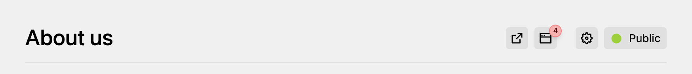
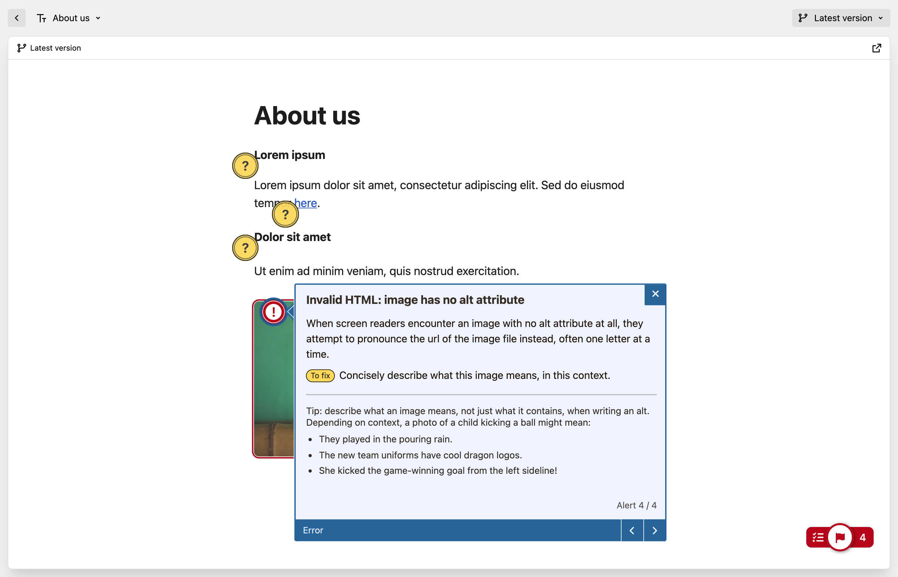

# Kirby Editoria11y

Make accessibility issues visible to editors in the Kirby Panel, powered by [Editoria11y](https://editoria11y.com).

## Installation

```
composer require medienbaecker/kirby-editoria11y
```

Or download this repository and put it in `site/plugins/kirby-editoria11y`.

Requires Kirby 5. No configuration needed. The checker is automatically set to the logged-in account's Panel language.

## How it works

The preview button automatically shows the number of alerts for the current page. Opening a page in the Panel checks it in the background:



In the page preview, editors see what to fix. Errors stay until they're fixed. Warnings can be dismissed: "Mark OK" hides one for all editors, "Ignore" only for the editor who clicked it.



In the Accessibility view you can check all pages at once:


## Storage

Check results and dismissed warnings are stored in an SQLite database, per page and language: `site/logs/editoria11y/editoria11y.sqlite` (in Kirby's logs folder). Nothing is written to your content files. When a page is deleted, its entries are deleted too.

## Options

```php
'medienbaecker.editoria11y' => [
	// Pages in the overview (default: all pages)
	'pages' => fn () => collection('sitemap'),

	// Passed to Editoria11y, e.g. to ignore alerts caused by templates
	'config' => [
		'ignoreByTest' => [
			'QA_FAKE_HEADING' => ':not(.rich-text *)',
		],
	],

	// Path to the SQLite database
	'database' => fn () => kirby()->root('logs') . '/editoria11y/editoria11y.sqlite',
],
```

The `pages` option takes a function that returns a pages collection. I tend to have a `sitemap` collection in my sites that I also use for, well, the sitemap.

## License

GPL-2.0. Bundles Editoria11y 3.0.2 ([source](https://github.com/itmaybejj/editoria11y/tree/3.0.2)).
