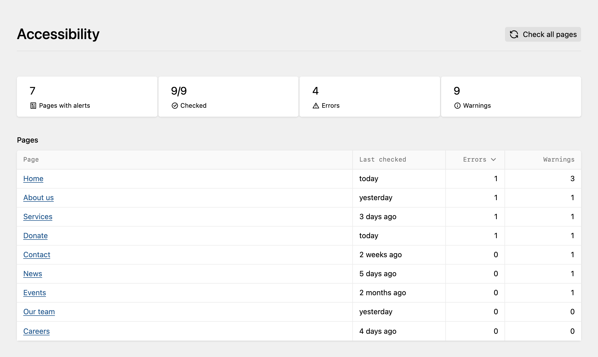

# Kirby Editoria11y

Runs the [Editoria11y](https://editoria11y.com) accessibility checker in the Panel preview. An Accessibility area in the Panel lists the results of all pages and can check them all at once; the preview button shows the number of alerts per page.



```
composer require medienbaecker/kirby-editoria11y
```

## Options

```php
'medienbaecker.editoria11y' => [
	'config'   => ['checkRoot' => 'main'], // passed to Editoria11y, or fn ($page) => [...]
	'pages'    => fn () => site()->index(),  // pages in the overview
	'enabled'  => fn ($page, $user) => …,    // default: Panel users who may update the page
	'database' => fn () => …,                 // SQLite file, default site/logs/editoria11y/
],
```

## License

GPL-2.0. Bundles Editoria11y 3.0.2 ([source](https://github.com/itmaybejj/editoria11y/tree/3.0.2)).
